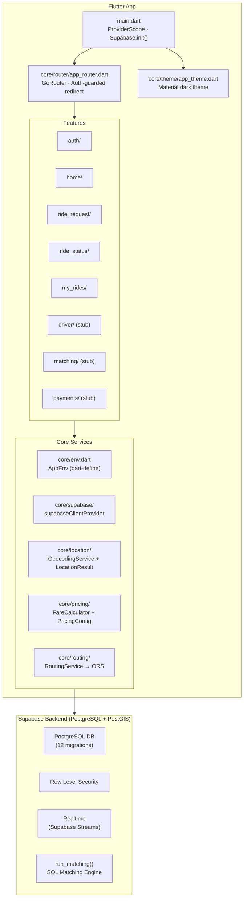
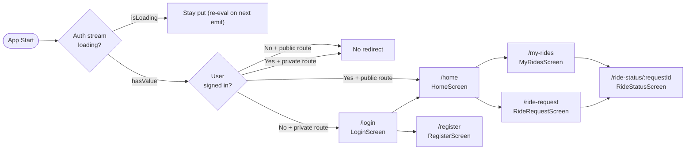
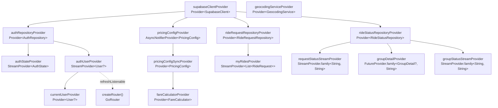
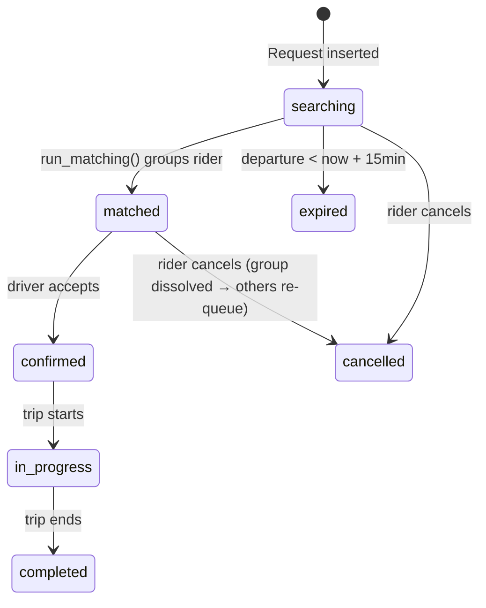
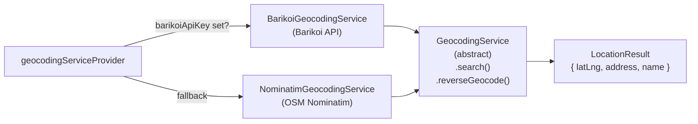
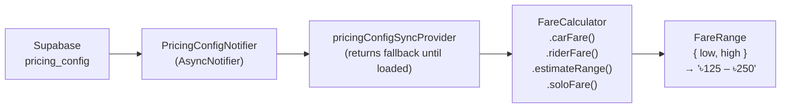
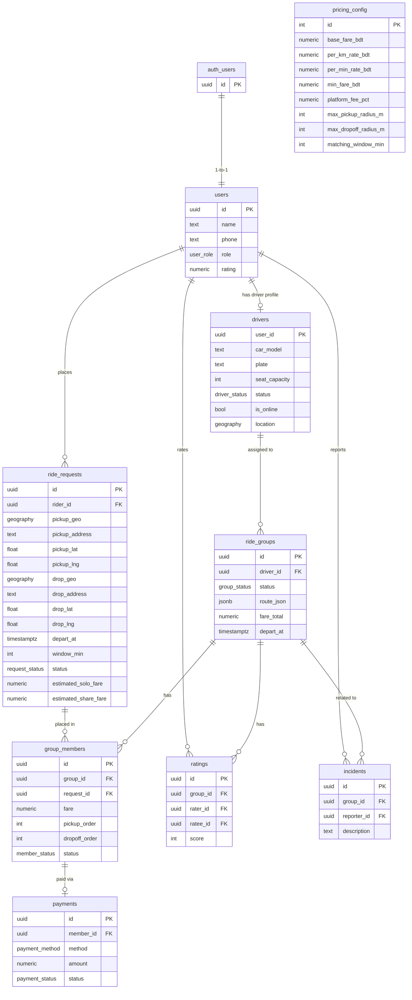
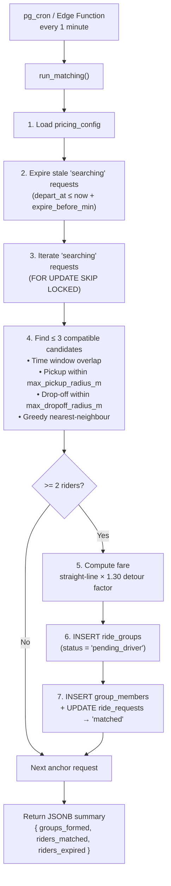
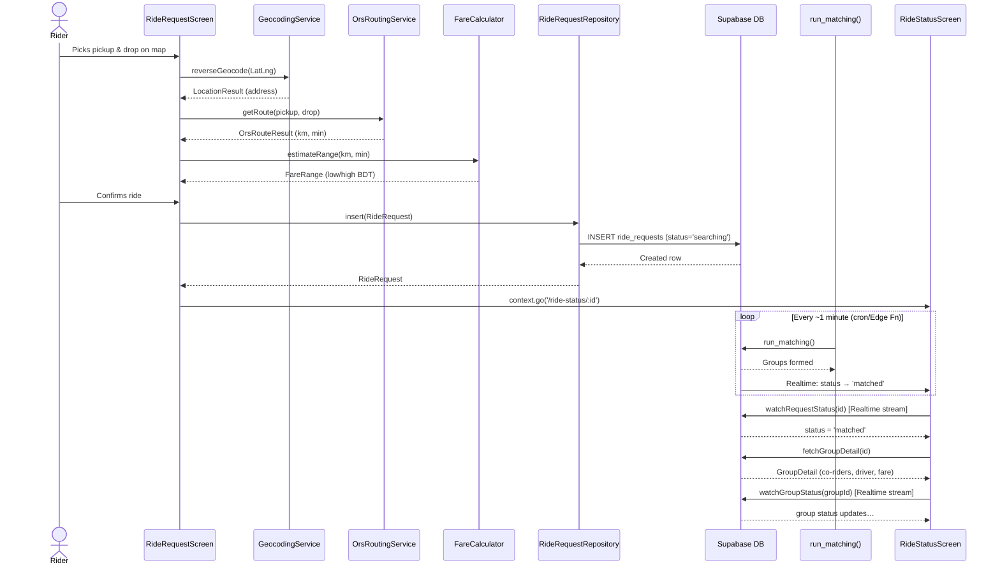

# ShareGari — Codebase Graph

> **ShareGari** is a Flutter shared-ride app for Dhaka commuters.  
> Stack: Flutter + Riverpod + GoRouter + Supabase (PostGIS) + OpenRouteService

---

## 1. High-Level Architecture



---

## 2. App Routing & Navigation



**Route constants** — [`AppRoutes`](file:///e:/WorkSpace/AntiGravity/sharegari/lib/core/router/app_router.dart#L13-L27)

| Route | Screen |
|---|---|
| `/login` | `LoginScreen` |
| `/register` | `RegisterScreen` |
| `/` | `HomeScreen` |
| `/ride-request` | `RideRequestScreen` |
| `/my-rides` | `MyRidesScreen` |
| `/ride-status/:requestId` | `RideStatusScreen` |

---

## 3. Riverpod Provider Dependency Graph



---

## 4. Feature Module Breakdown

### 4.1 `auth/`

```
auth/
├── login_screen.dart          — Email/password sign-in UI
├── register_screen.dart       — Sign-up with name/phone/role
├── data/
│   └── auth_repository.dart   — AuthRepository (signUp, signIn, signOut)
└── providers/
    └── auth_providers.dart    — authStateProvider, authUserProvider, currentUserProvider
```

**Key class:** [`AuthRepository`](file:///e:/WorkSpace/AntiGravity/sharegari/lib/features/auth/data/auth_repository.dart#L21-L96) — wraps `SupabaseClient.auth`; never throws, returns `AuthResult`.

---

### 4.2 `ride_request/`

```
ride_request/
├── ride_request_screen.dart   — Map + form to submit a new ride request
├── data/
│   ├── ride_request_model.dart     — RideRequest, RideRequestStatus enum
│   └── ride_request_repository.dart — insert(), cancel(), fetchMyRides(), watchMyRides()
├── providers/
│   └── ride_request_providers.dart — myRidesProvider (Realtime stream)
└── widgets/
    ├── map_picker.dart              — FlutterMap with draggable marker
    └── location_search_sheet.dart   — Geocoding search bottom sheet
```

**Key flows:**
- Rider picks pickup & drop on map → geocoded via `GeocodingService`
- `OrsRoutingService` fetches route distance/duration
- `FareCalculator.estimateRange()` shows fare estimate (BDT range)
- Confirmed → `RideRequestRepository.insert()` → Supabase; navigates to `RideStatusScreen`

---

### 4.3 `ride_status/`

```
ride_status/
├── ride_status_screen.dart    — Live status tracker (28 KB, most complex screen)
├── data/
│   ├── ride_status_models.dart     — GroupStatus enum, CoRider, DriverDetail, GroupDetail
│   └── ride_status_repository.dart — watchRequestStatus(), fetchGroupDetail(), watchGroupStatus(), cancelRequest()
└── providers/
    └── ride_status_providers.dart  — requestStatusStreamProvider, groupDetailProvider, groupStatusStreamProvider
```

**Status state machine:**



---

### 4.4 `my_rides/`

Single screen [`MyRidesScreen`](file:///e:/WorkSpace/AntiGravity/sharegari/lib/features/my_rides/my_rides_screen.dart) — live list of all of the rider's requests via `myRidesProvider` (Supabase Realtime `.stream()`).

---

### 4.5 Stub Features (placeholder files only)

| Feature | File | Status |
|---|---|---|
| `driver/` | `driver.dart` | Stub |
| `matching/` | `matching.dart` | Stub |
| `payments/` | `payments.dart` | Stub |

---

## 5. Core Services

### 5.1 Location / Geocoding



### 5.2 Routing (ORS)

```
core/routing/
├── routing_service.dart     — abstract RoutingService { getRoute(), getRouteMulti() }
└── ors_routing_service.dart — OpenRouteService HTTP impl; returns OrsRouteResult
```

`OrsRouteResult` exposes `.distanceKm` and `.durationMin` for fare computation.

### 5.3 Pricing



**Fare formula:**
```
car_fare  = max(min_fare, base + per_km × km + per_min × min)
rider_fare = roundUp5(car_fare / n_riders × (1 + platform_fee_pct))
```

---

## 6. Database Schema (PostgreSQL + PostGIS)



---

## 7. Matching Engine (`run_matching()`)

Lives entirely in SQL ([`007_matching_engine_schema.sql`](file:///e:/WorkSpace/AntiGravity/sharegari/supabase/migrations/007_matching_engine_schema.sql)).



**PostGIS functions used:** `ST_DWithin()`, `ST_Distance()` (geography sphere metres)

---

## 8. Migration Timeline

| # | File | Key Changes |
|---|---|---|
| 001 | `001_initial_schema.sql` | Full schema, enums, RLS, `pricing_config` seed |
| 002 | `002_auth_trigger.sql` | Postgres trigger: auto-insert `public.users` on `auth.users` insert |
| 003 | `003_pricing_v2.sql` | Adds `per_min_rate_bdt`, `min_fare_bdt` to `pricing_config` |
| 004 | `004_geo_latlong_columns.sql` | Adds generated `pickup_lat/lng`, `drop_lat/lng` columns (avoids hex EWKB) |
| 005 | `005_realtime_publication.sql` | Enables Supabase Realtime on `ride_requests`, `ride_groups` |
| 006 | `006_matching_engine.sql` | Adds `'searching'` & `'pending_driver'` enum values |
| 007 | `007_matching_engine_schema.sql` | `run_matching()` SQL function + `matching_window_min` config |
| 008 | `008_fix_phone_nullable.sql` | Makes `phone` nullable (optional at signup) |
| 009 | `009_fix_uuid_generate.sql` | Fixes `uuid_generate_v4()` availability on all Supabase plans |
| 010 | `010_rider_status_screen.sql` | `my_group_co_riders` view; `cancel_ride_request()` function |
| 011 | `011_matching_lookahead_and_dates.sql` | `run_matching()` 7-day lookahead, cross-date isolation, 15-min expiry |
| 012 | `012_open_groups_prebooking.sql` | Open groups for pre-booking, price drop on join, 120-min cutoff |

---

## 9. Key External Dependencies

| Package | Version | Purpose |
|---|---|---|
| `flutter_riverpod` | ^2.6.1 | State management |
| `riverpod_annotation` | ^2.5.2 | Code-gen annotations |
| `go_router` | ^14.6.2 | Declarative navigation |
| `supabase_flutter` | ^2.8.1 | Auth, DB, Realtime |
| `flutter_map` | ^7.0.2 | OSM map rendering |
| `latlong2` | ^0.9.1 | `LatLng` type |
| `http` | ^1.2.2 | Barikoi / Nominatim / ORS HTTP calls |
| `google_fonts` | ^6.2.1 | Typography |
| `intl` | ^0.20.1 | Date formatting in MyRidesScreen |

---

## 10. Data Flow: End-to-End Ride Request


